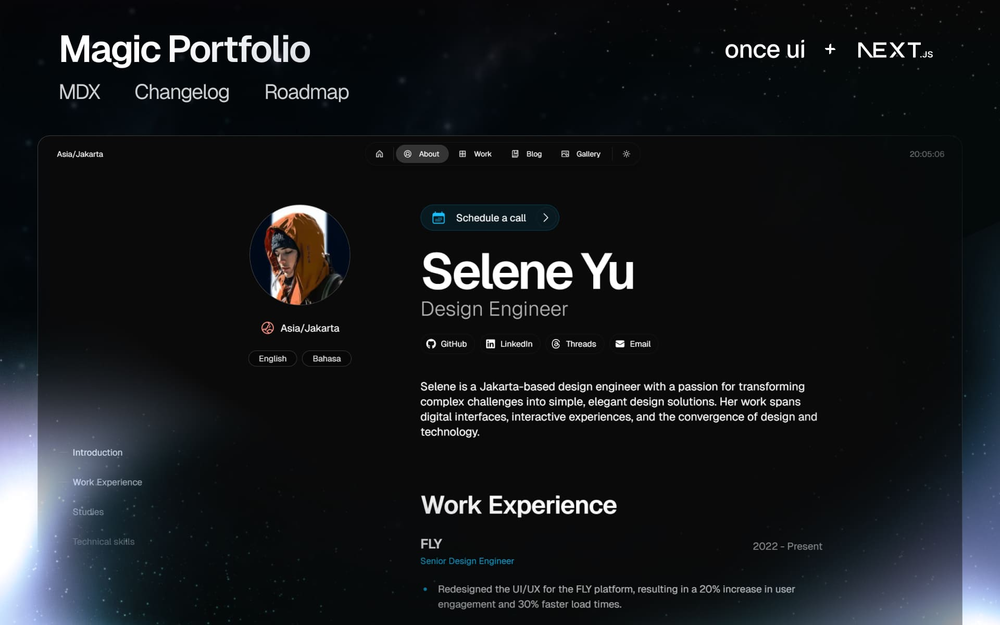

# Furkan Tosun · Portfolio

Personal portfolio built with Next.js, Once UI, and MDX. The home and about pages reflect the supplied CV: fourth-year Computer Engineering studies at Akdeniz University (expected graduation 2027), the Sütaş and Sarıtay Bilişim internships, technical skills, certifications, and English B2.

## Local development

```sh
npm ci
npm run dev
```

Open `http://localhost:3000`. Run `npm run build` for a production build and `npm start` to serve it. Geist fonts are bundled locally, so the build does not need Google Fonts access.

## Updating the portfolio

- Profile, experience, education, certifications, and skills: `src/resources/content.tsx`.
- Domain, enabled routes, theme, and fonts: `src/resources/once-ui.config.ts`.
- Project pages: `src/app/work/projects/*.mdx`. Internship projects are described using the CV; SutasGPT is labeled as a prototype.
- Downloadable CV: `public/FurkanTosun.pdf`. Replace this file when the CV changes.
- Homepage layout: `src/app/page.tsx` and `src/app/page.module.scss`.
- SutasGPT animated cover: `src/components/work/SutasKnowledgeGraph.tsx`. Selected wiki topic labels and illustrative connections live in `sutasGraph.ts`; no internal document content is included. Set `cover: "sutas-graph"` in project frontmatter to use it. The animation supports pause/resume, reduced motion, and stops when outside the viewport or in a hidden tab.
- Sociact graduation project: `src/app/work/projects/sociact.mdx`. Its original landing-page assets and adapted, standalone product presentation live in `public/previews/sociact/`; `SociactShowcase.tsx` embeds the preview with scripts disabled. Set `cover: "sociact-landing"` to display it. The old `/work/ai-social-media-management` URL redirects to `/work/sociact`.
- TSN Media: `src/app/work/projects/tsn-agentic.mdx`, based on the public `furkantosun1607/tsn-website` Angular frontend and `furkantosun1607/tsn-agentic` workers. `TsnShowcase.tsx` renders a vertical, photo-led news feed using `tsnFeed.ts` and local NASA archive images; dates, article sources, and image credits are included. Image provenance is recorded in `public/images/projects/tsn/CREDITS.md`. `TsnPipelineDemo.tsx` and `tsnDemo.ts` retain the interactive quality-gate illustration inside an expandable section. Set `cover: "tsn-pipeline"` to display both. The old template-named project URL redirects to `/work/tsn-agentic`.

The existing personal projects and gallery are preserved. The blog and newsletter remain disabled. The canonical domain is `https://furkantosun.me`; local changes do not deploy the website.

## Original template

Magic Portfolio is a simple, clean, beginner-friendly portfolio template. It supports an MDX-based content system for projects and blog posts, an about / CV page and a gallery.

View the demo [here](https://demo.magic-portfolio.com).



## Getting started

**1. Clone the repository**
```
git clone https://github.com/once-ui-system/magic-portfolio.git
```

**2. Install dependencies**
```
npm install
```

**3. Run dev server**
```
npm run dev
```

**4. Edit config**
```
src/resources/once-ui.config.js
```

**5. Edit content**
```
src/resources/content.js
```

**6. Create blog posts / projects**
```
Add a new .mdx file to src/app/blog/posts or src/app/work/projects
```

Magic Portfolio was built with [Once UI](https://once-ui.com) for [Next.js](https://nextjs.org). It requires Node.js v18.17+.

## Documentation

Docs available at: [docs.once-ui.com](https://docs.once-ui.com/docs/magic-portfolio/quick-start)

## Features

### Once UI
- All tokens, components & features of [Once UI](https://once-ui.com)

### SEO
- Automatic open-graph and X image generation with next/og
- Automatic schema and metadata generation based on the content file

### Design
- Responsive layout optimized for all screen sizes
- Timeless design without heavy animations and motion
- Endless customization options through [data attributes](https://once-ui.com/docs/theming)

### Content
- Render sections conditionally based on the content file
- Enable or disable pages for blog, work, gallery and about / CV
- Generate and display social links automatically
- Set up password protection for URLs

### Localization
- A localized, earlier version of Magic Portfolio is available with the next-intl library
- To use localization, switch to the 'i18n' branch

## Creators

Lorant One: [Threads](https://www.threads.net/@lorant.one) / [LinkedIn](https://www.linkedin.com/in/lorant-one/)

## Get involved

- Join the Design Engineers Club on [Discord](https://discord.com/invite/5EyAQ4eNdS) and share your project with us!
- Deployed your docs? Share it on the [Once UI Hub](https://once-ui.com/hub) too! We feature our favorite apps on our landing page.

## License

Distributed under the CC BY-NC 4.0 License.
- Attribution is required.
- Commercial usage is not allowed.
- You can extend the license to [Dopler CC](https://dopler.app/license) by purchasing a [Once UI Pro](https://once-ui.com/pricing) license.

See `LICENSE.txt` for more information.

## Deploy with Vercel

[](https://vercel.com/new/clone?repository-url=https%3A%2F%2Fgithub.com%2Fonce-ui-system%2Fmagic-portfolio&project-name=portfolio&repository-name=portfolio&redirect-url=https%3A%2F%2Fgithub.com%2Fonce-ui-system%2Fmagic-portfolio&demo-title=Magic%20Portfolio&demo-description=Showcase%20your%20designers%20or%20developer%20portfolio&demo-url=https%3A%2F%2Fdemo.magic-portfolio.com&demo-image=%2F%2Fraw.githubusercontent.com%2Fonce-ui-system%2Fmagic-portfolio%2Fmain%2Fpublic%2Fimages%2Fog%2Fhome.jpg)
